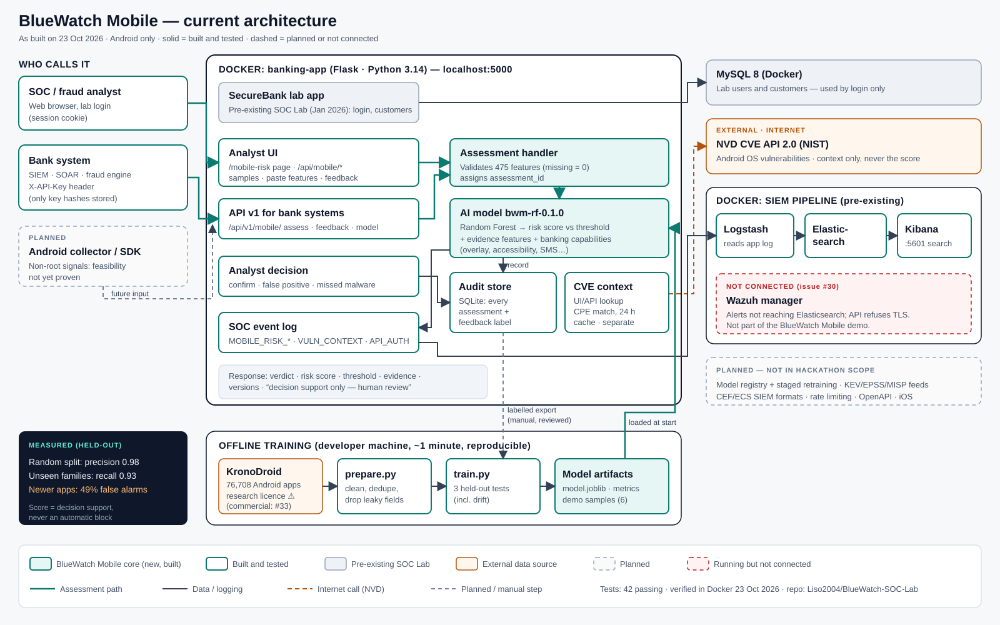

# BlueWatch Mobile — Android app risk triage (YES AI Hackathon 2026, Challenge 3)

Prototype, not a production malware-protection product. It scores pre-extracted Android app
features and gives a SOC analyst a risk score with supporting evidence. A human decides what
happens next; nothing here blocks accounts or devices.



Scope: see [docs/SCOPE_FREEZE.md](docs/SCOPE_FREEZE.md) — features are frozen until the video
and pitch are done. **AI, data, API and third-party disclosure (required by the organisers):
[DISCLOSURE.md](DISCLOSURE.md).**

## Status (23 Oct 2026)

| Component | Status | Where |
|---|---|---|
| Data preparation (KronoDroid real-device) | Implemented, run | `ml/prepare.py` |
| Random Forest baseline + 3-split evaluation | Implemented, run | `ml/train.py` → `insider-threat-lab/app/mobile_risk/artifacts/` |
| Inference API (Flask blueprint, login-protected) | Implemented, tested (16 tests) | `insider-threat-lab/app/mobile_risk/` |
| Analyst page `/mobile-risk` | Implemented; verified over HTTP in Docker (login → page → API); visual click-through pending | `insider-threat-lab/app/templates/mobile_risk.html` |
| SOC logging (`MOBILE_RISK_ASSESSMENT`, `VULN_CONTEXT_LOOKUP` → existing ELK/Wazuh log) | Implemented, verified in Docker | same log as banking app |
| Six labelled demo cases | Run, all six match their dataset label | `evidence/demo_cases.md` |
| Docker image with model runtime | Built and running (python:3.14-slim); scores match local run | `insider-threat-lab/app/dockerfile` |
| Android platform CVE context (NVD API 2.0) | Implemented, tested (11 offline tests), live-verified for Android 13 | `insider-threat-lab/app/mobile_risk/nvd.py` |
| Android on-device collector | Planned — not started | — |
| App-level vulnerability matching (app/component versions) | Planned — dataset has no version data | — |
| Malware threat-intel feeds (e.g. MISP) | Planned — not started | — |
| Model registry / staged retraining | Planned — not started | — |

## How it fits the existing SOC Lab

BlueWatch SOC Lab (Jan 2026, pre-existing) is a Flask/MySQL banking app with ELK and Wazuh.
BlueWatch Mobile was added during the hackathon as a module inside that app: an analyst logs
in, opens **BlueWatch Mobile — Android App Risk** from the dashboard, scores an app, and each
assessment is written to the same security log that Logstash and Wazuh already ingest.

## Data

- **Source:** KronoDroid real-device v1 — https://github.com/aleguma/kronodroid (files
  `real_legitimate_v1.zip`, `real_malware_v1.zip`, retrieved 2026-10-23; SHA-256 in
  `insider-threat-lab/app/mobile_risk/artifacts/metrics.json`).
- **Citation (required by the dataset author):** A. Guerra-Manzanares, H. Bahsi, S. Nõmm,
  "KronoDroid: Time-based Hybrid-featured Dataset for Effective Android Malware Detection and
  Characterization", *Computers & Security* 110 (2021) 102399,
  https://doi.org/10.1016/j.cose.2021.102399
- **Terms:** released publicly "for research purpose" with the citation condition (dataset
  README). Commercial use beyond research needs the author's permission — open item.
- **What is used:** pre-extracted CSV features only (289 system-call counts, permissions,
  manifest counts). No APKs, no malware binaries, no personal data. Raw files are git-ignored.
- **Excluded from training to prevent label leakage:** `Detection_Ratio`, `Scanners`,
  `TimesSubmitted` (antivirus metadata), `MalFamily`, `Package`, `sha256`, dates.
- **After cleaning:** 76,708 apps (35,778 benign, 40,930 malware, 235 families), 475 features,
  dated 2008–2020. Dropped: 1,421 invalid dates, 8 hashes with conflicting labels.

## Integrating with a bank's systems (API v1)

System-to-system calls use `/api/v1/mobile/*` with an API key; browser sessions are not
accepted there. Only SHA-256 hashes of keys are configured.

```bash
# 1. Create a key per client system (prints the key once + the .env line)
cd insider-threat-lab/app && python -m mobile_risk.apikeys new soc-siem
# 2. Put the printed "soc-siem:<hash>" in BLUEWATCH_API_KEYS in .env, restart the container
# 3. Call it
curl -H "X-API-Key: <key>" -H "Content-Type: application/json" \
     -d '{"sample_id":"app-ref-123","features":{"SEND_SMS":1,"RECEIVE_SMS":1,"SYSTEM_ALERT_WINDOW":1}}' \
     http://localhost:5000/api/v1/mobile/assess
```

| Endpoint | Purpose |
|---|---|
| `POST /api/v1/mobile/assess` | Score an app's features → `assessment_id`, verdict, risk score, threshold, evidence, banking-related capabilities, versions |
| `POST /api/v1/mobile/feedback` | `{assessment_id, label, note?}` — `confirmed_malicious`, `false_positive` (flagged) or `confirmed_benign`, `missed_malware` (not flagged) |
| `GET /api/v1/mobile/model` | Model/feature versions, full feature schema, threshold, evaluation results |
| `GET /api/v1/mobile/vulnerabilities?android_version=13.0` | Android CVE context (NVD) |

- **Audit trail:** every assessment is stored with model and feature versions, caller and
  channel (`MOBILE_RISK_DB`, SQLite; mounted at `insider-threat-lab/bluewatch_data/`). No
  personal data is stored — only the app's feature counts.
- **Feedback → training data:** analyst decisions are stored and logged
  (`MOBILE_RISK_FEEDBACK`); `GET /api/mobile/feedback/export` (analyst login) downloads labelled
  cases as JSONL for the next reviewed training run. Feedback never changes a score by itself.
- **Per-bank threshold:** `MOBILE_RISK_THRESHOLD` (0–1) sets the review cut-off to match analyst capacity.
- **SIEM events:** `MOBILE_RISK_ASSESSMENT`, `MOBILE_RISK_FEEDBACK`, `VULN_CONTEXT_LOOKUP`,
  `API_AUTH_FAILED` in the app log, ingested by Logstash.
- **Not yet built:** rate limiting, key rotation procedure, OpenAPI document, SIEM-specific
  formats (CEF/ECS), mobile SDK/collector.

## Vulnerability context (NVD)

`GET /api/mobile/vulnerabilities?android_version=13.0` lists published CVEs that NVD marks as
affecting that Android OS version. It is shown in its own panel and **never changes the
malware verdict**: a CVE is platform exposure, not evidence an app is malicious, and no CVE
does not lower risk.

- **Source:** NVD CVE API 2.0, `virtualMatchString=cpe:2.3:o:google:android:<version>`, paged
  500 at a time, 6 s between requests without an API key (NVD's public rate limit), bounded
  retries, 24-hour cache in `insider-threat-lab/nvd_cache/` (git-ignored, mounted into Docker).
- **Matching:** keeps a CVE only if a configuration marks `cpe:2.3:o:google:android` as
  *vulnerable* for that version — `exact` (named version) or `range` (inside version bounds).
  "Any version" CPEs are counted but not listed; CVEs where Android is only the platform a
  vulnerable app runs on are dropped. No keyword matching.
- **Live result (Android 13.0, retrieved 2026-10-23 13:44 UTC):** 1,700 NVD candidates →
  1,574 exact + 99 range matches (32 critical, 567 high, 1,001 medium, 73 low CVSS).
- **First lookup per version takes ~6 minutes** without an API key; warm the cache before a
  demo: `cd insider-threat-lab/app && NVD_CACHE_DIR=../nvd_cache python -m mobile_risk.nvd 13.0 14.0`.
  Setting `NVD_API_KEY` in `.env` shortens this.
- **Attribution:** "This product uses the NVD API but is not endorsed or certified by the NVD."

## Model and measured results

`sklearn.ensemble.RandomForestClassifier` (scikit-learn 1.9.1; 150 trees, max depth 25,
balanced class weights, seed 42). Threshold 0.5. The score is the fraction of trees voting
"malware" — an uncalibrated risk score, **not a probability**.

| Split | Test n | Precision | Recall | F1 | FPR | PR-AUC |
|---|---|---|---|---|---|---|
| A — random stratified 80/20 (**deployed model**) | 15,342 | 0.982 | 0.966 | 0.974 | 2.0% | 0.997 |
| B — per-class temporal 80/20 (newest 20% of each class) | 15,342 | 0.691 | 0.963 | 0.805 | **49.1%** | 0.976 |
| C — unseen malware families | 20,950 | 0.989 | 0.930 | 0.959 | 2.0% | 0.996 |

Source of truth: `insider-threat-lab/app/mobile_risk/artifacts/metrics.json`. Quote these
together — never split A alone.

## Known limitations

1. **Concept drift is severe.** Trained on older apps, the model flags ~half of newer benign
   apps (split B). 65% of benign apps in the dataset (23,085 of 35,778) are dated 2011, while malware peaks 2012–2018,
   so the model partly learns app era. Tuning the threshold on a temporal validation slice
   did not fix it (validation FPR 3.7% vs test 49%). This is the core problem the product must
   solve with recent benign data and governed retraining.
2. **Mostly static signal.** The most important features are permissions and manifest counts
   (`READ_PHONE_STATE`, `SEND_SMS`, permission totals); system calls contribute less. It is a
   hybrid static/dynamic model, not purely behavioural.
3. **Research dataset ≠ device telemetry.** Features came from instrumented collection; a
   non-root Android app cannot observe system calls directly. Collector feasibility is unproven.
4. **Six demo cases show the workflow, not efficacy.** All three benign demo samples are
   2011 apps — the era the model handles best.
5. **Evidence is not explanation.** The evidence table ranks features by model importance ×
   distance from the benign median; it is supporting context, not causal attribution.

## Reproduce (commands tested on Windows, Python 3.14.2)

```bash
pip install -r insider-threat-lab/app/requirements.txt pytest
mkdir -p bluewatch-mobile/data/raw && cd bluewatch-mobile/data/raw
curl -LO https://raw.githubusercontent.com/aleguma/kronodroid/main/real_device/real_legitimate_v1.zip
curl -LO https://raw.githubusercontent.com/aleguma/kronodroid/main/real_device/real_malware_v1.zip
cd ../../..
python bluewatch-mobile/ml/prepare.py          # ~20 s
python bluewatch-mobile/ml/train.py            # ~40 s, writes artifacts
python -m pytest insider-threat-lab/app/tests  # 27 tests, offline
docker compose up -d --build banking-app mysql # then http://localhost:5000 → login → dashboard
```

Docker verified 2026-10-23: lab login as `analyst`, `/mobile-risk` 200, assessment and NVD lookup over HTTP, both events in `insider-threat-lab/logs/app/banking_app.log`.

## Responsible use

- Decision support only; the UI and every API response say so.
- No credentials, OTPs, message bodies or personal data are collected or used.
- Model, features and dataset versions are returned with every assessment and logged.
- No POPIA-compliance claim; a real deployment needs a privacy and legal assessment.

## AI-assisted development (to be completed by the team)

- **Claude Code (Anthropic, Claude Opus 5.5)** — used on 2026-10-23 for repository audit,
  secret scanning, project-board generation, and writing `ml/prepare.py`, `ml/train.py`,
  `mobile_risk/`, the analyst page, tests and this README. Reviewed and accepted by: _team to
  confirm_.
- **ChatGPT / Codex** — disclosed in the application; _team to confirm actual use in this repo_.
